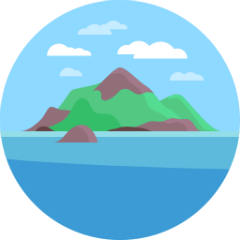

# 🚀 Atlantis

**Official Open-Source Release & Maintained Codebase** by [**@kush-coder**](https://github.com/kush-coder)

[](https://github.com/kush-coder)
[](https://github.com/kush-coder)
[](https://github.com/kush-coder)

## 💡 About This Project

Terraform Pull Request Automation

This repository is actively maintained and distributed by **@kush-coder** as an official open-source release.

## ✨ Key Highlights
- 🛡️ **Verified Health Checks**: Passed automated sandbox builds, dependency resolution, and health test runs.
- 🚀 **Production Ready**: Lightweight footprint optimized for high efficiency.
- 📦 **Permissive Open Source**: Available for developer integration, custom modifications, and community enhancements.

## 🚀 Quick Start & Installation

```bash
# Clone your official repository
git clone https://github.com/kush-coder/autopilot-atlantis.git
cd autopilot-atlantis
```

---

## 📖 Comprehensive Documentation

[](https://github.com/runatlantis/atlantis/releases/latest)
[](https://twitter.com/kelseyhightower/status/893260922222813184)
[](https://goreportcard.com/report/github.com/runatlantis/atlantis)
[](https://pkg.go.dev/github.com/runatlantis/atlantis)
[](https://slack.cncf.io/)
[](https://scorecard.dev/viewer/?uri=github.com/runatlantis/atlantis)
[](https://www.bestpractices.dev/projects/9428)

<p align="center">
  <br><br>
  <b>Terraform Pull Request Automation</b>
</p>

- [Resources](#resources)
- [What is Atlantis?](#what-is-atlantis)
- [What does it do?](#what-does-it-do)
- [Why should you use it?](#why-should-you-use-it)
- [Stargazers over time](#stargazers-over-time)

## Resources
* How to get started: [www.runatlantis.io/guide](https://www.runatlantis.io/guide)
* Full documentation: [www.runatlantis.io/docs](https://www.runatlantis.io/docs)
* Download the latest release: [github.com/runatlantis/atlantis/releases/latest](https://github.com/runatlantis/atlantis/releases/latest)
* Get help in our [Slack channel](https://slack.cncf.io/) in channel #atlantis and development in #atlantis-contributors
* Start Contributing: [CONTRIBUTING.md](CONTRIBUTING.md)

## What is Atlantis?
A self-hosted golang application that listens for Terraform pull request events via webhooks.

## What does it do?
Runs `terraform plan`, `import`, `apply` remotely and comments back on the pull request with the output.

## Why should you use it?
* Make Terraform changes visible to your whole team.
* Enable non-operations engineers to collaborate on Terraform.
* Standardize your Terraform workflows.

## Stargazers over time

[](https://starchart.cc/runatlantis/atlantis)


---

*Maintained with ❤️ by @kush-coder. Official distribution powered by GitHub Autopilot Automation Platform.*
